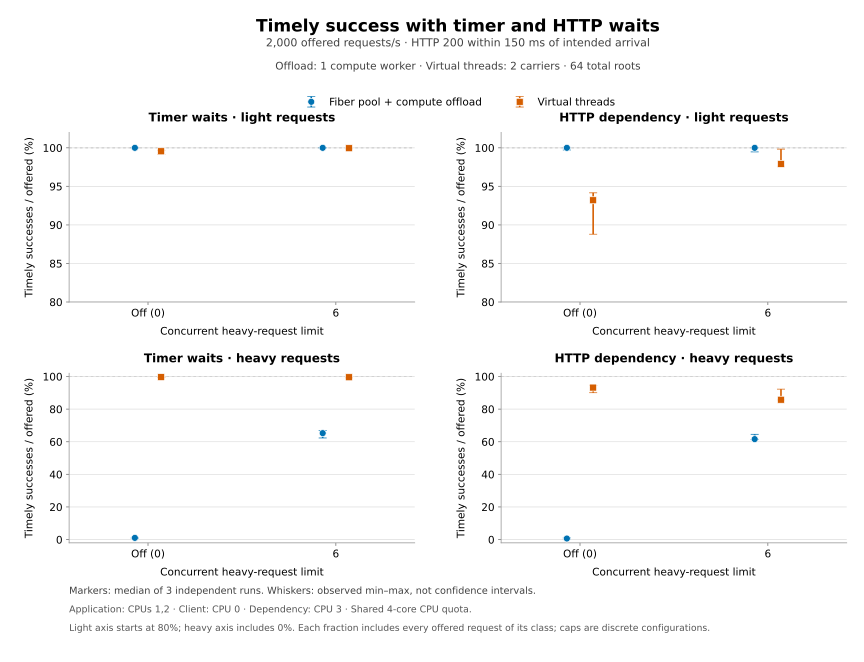
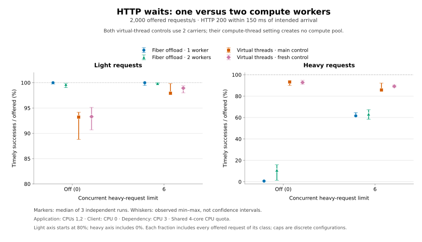

# Real downstream HTTP and compute-width sensitivity

Limiting concurrent heavy requests improved the one-worker fiber setup with
real downstream HTTP. At 2,000 offered requests/s, cap 6 raised median timely
goodput from **1,785 to 1,917/s (+7.43%)** and heavy timely success from
**0.650% to 61.600%**. Similar total throughput still concealed a class tradeoff:
matched virtual threads served a higher fraction of heavy traffic, while
fibers protected light traffic and its latency better in these runs.

Adding a second compute worker on the same two application CPUs did **not**
produce a stable improvement with cap 6: median goodput was **1,921/s**, with
overlapping ranges, while light successful p99 rose from **12.426 to 25.742 ms**.
These results do not justify changing the compute-width default. The complete
comparison contains 60 validated runs on one source revision and JAR; an earlier
aborted series exposed a reproducible cancellation/cleanup defect that was
fixed before restarting all measurements.

## Setup and reproducibility

Source: [`e88d6f8`](https://github.com/RostMyr/jfibers/commit/e88d6f89722961f44d6f24b65a05253c6e415412), pushed to `main`.
Both series started with clean trees; all 26 benchmark source hashes match.
Benchmark JAR SHA-256:
`07c920023ba68e6f638c7b165ce96f7b1c5992b62b3d43aa257ad88ece3be74f`.
Both series have identical source hashes, commit and benchmark artifact.

The environment is Linux on an AMD EPYC 9V74 guest, Temurin 27+35 and Maven
3.10.0, with five visible logical CPUs and a shared four-CPU cgroup quota
(`400000 / 100000` microseconds). Each JVM starts with disjoint `taskset` affinity:

| Process | Allowed logical CPUs | JVM active processors |
| --- | --- | ---: |
| Load generator | 0 | 1 |
| Application | 1,2 | 2 |
| HTTP dependency | 3 | 1 |

These are logical CPU masks inside one guest, not exclusive physical cores or
independent quotas. CPU 4 is not assigned to a measured JVM. Boundary checks
confirm the masks of observed live threads, not continuous scheduling history.

Normal requests perform three sequential wait/compute rounds. The fixed ID
classifier makes 90% light requests with 1,000 CPU iterations per round and 10%
heavy requests with 1,000,000. HTTP mode uses `HttpClient.sendAsync` to call a
separate loopback HTTP/1.1 dependency; timer mode keeps local scheduled waits.
The dependency schedules a 1 ms delay without blocking its handler, then returns
24 validated bytes containing request ID, step and value 42. The configured
1 ms delay is not an observed HTTP round-trip measurement; none was recorded.

Global admission is 64 roots; the heavy gate is disabled (`0`) or set to `6`.
Both backends retain slots through I/O and cancellation cleanup. The client has
512 in-flight slots, open-loop arrivals, identical phase IDs and no business
retries. A 100 ms server deadline requests cooperative termination; a separate
150 ms client SLO runs from intended arrival through the complete response.
Cancellation wakes the body observer without aborting its physical HTTP call.
Cleanup awaits that call, bounded by a five-second HTTP safety timeout, so a
final response can follow the server deadline. Keep-alive connections may remain
open after a call completes. Lifecycle `hold` probes keep synthetic local waits;
normal successful probes and measured traffic use the selected wait mode.

| Series | Wait modes | Offered requests/s | Compute workers | Heavy caps | Runs |
| --- | --- | --- | ---: | --- | ---: |
| Main | Timer, HTTP | 500, 2,000 | 1 | 0, 6 | 48 |
| Compute-width follow-up | HTTP | 2,000 | 2 | 0, 6 | 12 |

Each configuration has three fresh-JVM repetitions with 15 seconds of warmup
and 10 seconds of offered arrivals. Main fibers use one owner plus one compute
worker; the follow-up adds a second compute worker within the same two CPUs.
No CPU is reserved for the owner. VT uses two carriers and no compute executor;
its follow-up runs provide a contemporary control. JFR diagnostics are disabled.
Each run starts fresh client/application JVMs, plus a dependency JVM for HTTP.
No builds or other benchmarks ran concurrently with measurement.

Main run: **2026-10-11 03:57:03–04:19:23 UTC**.
Follow-up: **2026-10-11 04:19:32–04:25:13 UTC**.
[Protocol and command options](DOWNSTREAM_HTTP.md),
[main raw data](results/2026-10-11-downstream-http/results.json),
[environment](results/2026-10-11-downstream-http/environment.json),
[summary](results/2026-10-11-downstream-http/summary.json), and
[follow-up data](results/2026-10-11-downstream-http/two-workers/results.json).
Pilots are retained in [pilot-rates](results/2026-10-11-downstream-http/pilot-rates/)
and [pilot-low](results/2026-10-11-downstream-http/pilot-low/); they are not pooled
with the final measurement series. Those six pilot runs offered 35,000 measured
requests on the earlier source and selected 500/s and 2,000/s as load points.

After building the benchmark profile, reproduce the main matrix with:

```sh
python3 jfibers-benchmarks/request_http_run.py \
  --backends FIBER_POOL_OFFLOAD VIRTUAL_THREADS --cases 500:1000000 2000:1000000 \
  --heavy-capacities 0 6 --wait-modes timer http --compute-threads 1 \
  --dependency-delay-ms 1 --client-cpus 0 --server-cpus 1,2 --dependency-cpus 3 \
  --warmup-ms 15000 --measure-ms 10000 --forks 3 --output /path/to/new/main
```

The follow-up uses `--cases 2000:1000000 --wait-modes http --compute-threads 2`
and writes to a different new directory.

## Outcomes at 2,000 offered requests/s

Values are medians `[minimum, maximum]` across three runs; unchanged values are
shown once. Percentages below divide by all offered requests of that class.

| Mode | Backend | Heavy cap | Goodput/s | Light timely % | Heavy timely % | HTTP 504/run |
| --- | --- | ---: | ---: | ---: | ---: | ---: |
| http | Fibers | off | 1785 [1782, 1787] | 100.000 [99.722, 100.000] | 0.650 [0.350, 1.100] | 1979 [1978, 1993] |
| http | Fibers | 6 | 1917 [1909, 1926] | 100.000 [99.472, 100.000] | 61.600 [61.450, 64.550] | 0 |
| http | VT | off | 1861 [1775, 1880] | 93.200 [88.794, 94.161] | 93.200 [90.050, 94.500] | 0 |
| http | VT | 6 | 1930 [1925, 1977] | 97.911 [97.622, 99.833] | 85.750 [85.600, 92.250] | 0 |
| timer | Fibers | off | 1787 [1785, 1788] | 100.000 | 1.050 [0.750, 1.300] | 1979 [1974, 1985] |
| timer | Fibers | 6 | 1926 [1918, 1930] | 100.000 | 65.250 [62.300, 66.850] | 0 |
| timer | VT | off | 1989 [1981, 1991] | 99.556 [99.150, 99.678] | 99.600 [99.300, 99.700] | 0 |
| timer | VT | 6 | 1995 [1995, 1997] | 99.950 [99.861, 99.983] | 99.550 [99.050, 99.550] | 0 |

For HTTP fibers with one compute worker, cap 6 raises median goodput from
1,785 to 1,917/s (**7.43%**) and heavy timely success from **0.650% to 61.600%**.
Median light success is 100% for both caps, but cap 6 ranges from **99.472% to
100%**; some runs still refuse light requests through the global gate.
Without the heavy gate, 98.950% [98.900%, 99.650%] of offered heavy requests
expire. With cap 6, no measured request expires, and 38.400% [35.450%, 38.550%]
of offered heavy requests are refused by that gate. Successful heavy requests increase,
so the outcome change is more than relabelling timeouts as refusals.

VT with cap 6 reaches 1,930 [1,925, 1,977]/s, close to the fibers goodput range,
but heavy timely success is **85.750%** versus fibers' **61.600%**. Fibers have
higher median light timely success and lower successful light p99 in these
runs. These are class tradeoffs, not a demonstrated general backend winner.
For VT, cap 6 improves total goodput while lowering median heavy success from
93.200% to 85.750%; the heavy gate must therefore be assessed by class.



## Two compute workers on the same CPUs

Only the fiber compute executor changes width. Both VT controls still use two
carriers; they have no compute executor. These are separate sequential series,
not interleaved worker-width trials, so temporal variation remains a limitation.

| Backend | Heavy cap | Goodput/s | Light timely % | Heavy timely % | HTTP 504/run |
| --- | ---: | ---: | ---: | ---: | ---: |
| Fibers | off | 1810 [1775, 1816] | 99.667 [99.050, 99.883] | 10.850 [1.450, 15.850] | 1780 [1677, 1956] |
| Fibers | 6 | 1921 [1912, 1931] | 99.867 [99.861, 99.978] | 63.200 [58.500, 67.300] | 1 [0, 18] |
| VT | off | 1861 [1810, 1899] | 93.300 [90.694, 95.128] | 92.800 [91.000, 94.950] | 0 |
| VT | 6 | 1955 [1937, 1967] | 98.928 [98.011, 99.400] | 89.200 [88.150, 90.450] | 0 [0, 1] |

With cap 6, fiber heavy timely success changes from 61.600% to 63.200%, with
overlapping ranges. Goodput also overlaps: 1,917 [1,909, 1,926]/s versus
1,921 [1,912, 1,931]/s. Light p99 rises from 12.426 [7.845, 15.610] ms to
25.742 [21.723, 26.105] ms, whose observed ranges do not overlap. Timeouts change
from zero to 1 [0, 18] per run. More workers are not free capacity here.

The heavy compute-queue p50 falls from 28.891 to 12.108 ms, while application
CPU rises from 1.697 to 1.940 cores and successful-response latency worsens.
Queue residence alone therefore does not explain end-to-end latency. Without
the gate, two workers still time out 89.000% [83.850%, 97.800%] of offered heavy
requests. This narrows the next investigation to CPU/HTTP/owner scheduling costs
rather than establishing compute width as the complete cause of the gap.

The fresh cap-six VT control reaches 1,955 [1,937, 1,967]/s and 89.200% heavy
timely success. Its light timely fraction is 98.928%, versus fibers' 99.867%.
The tested fiber policy favors light traffic at the cost of heavy availability;
this is not an isolated comparison of scheduler overhead.




## Sustainable point and successful-response latency

At 500 offered requests/s, **all 120,000 measured requests across all eight
configurations** return timely HTTP 200. There are no measured refusals or
expirations. The following disabled-heavy-gate controls isolate the added HTTP
path under the same application CPU assignment:

| Mode | Backend | Light successful p99 ms | Heavy successful p99 ms | App average CPU cores |
| --- | --- | ---: | ---: | ---: |
| http | Fibers | 12.090 [10.838, 12.210] | 19.812 [18.218, 39.279] | 0.741 [0.702, 0.746] |
| http | VT | 12.369 [12.115, 14.719] | 19.235 [19.176, 21.755] | 0.766 [0.751, 0.823] |
| timer | Fibers | 7.327 [7.214, 8.838] | 18.710 [14.877, 29.391] | 0.505 [0.487, 0.535] |
| timer | VT | 8.435 [8.021, 9.275] | 17.946 [15.934, 20.464] | 0.506 [0.495, 0.552] |

The following table returns to HTTP at 2,000/s. Latency describes successful
responses only; refusal and expiration rates remain part of the outcome table.

| Series | Backend | Heavy cap | Light successful p99 ms | Heavy successful p99 ms | Heavy successes/run | Heavy compute queue p50 ms |
| --- | --- | ---: | ---: | ---: | ---: | ---: |
| Main | Fibers | off | 14.380 [10.988, 21.194] | 99.849 [98.760, 106.421] | 13 [7, 22] | 87.962 [87.153, 89.781] |
| Main | Fibers | 6 | 12.426 [7.845, 15.610] | 59.702 [49.735, 90.956] | 1232 [1229, 1291] | 28.891 [28.416, 28.989] |
| Main | VT | off | 50.160 [49.397, 52.881] | 58.336 [54.039, 59.755] | 1864 [1801, 1890] | 0.000 |
| Main | VT | 6 | 43.492 [34.144, 44.293] | 50.347 [40.408, 52.335] | 1715 [1712, 1845] | 0.000 |
| Two workers | Fibers | off | 22.173 [18.534, 29.324] | 104.252 [100.822, 104.483] | 217 [29, 317] | 73.107 [63.574, 77.071] |
| Two workers | Fibers | 6 | 25.742 [21.723, 26.105] | 87.402 [67.656, 99.740] | 1264 [1170, 1346] | 12.108 [10.589, 12.342] |
| Two workers | VT | off | 52.026 [51.816, 53.842] | 58.195 [58.070, 63.882] | 1856 [1820, 1899] | 0.000 |
| Two workers | VT | 6 | 40.449 [38.835, 44.540] | 47.103 [42.932, 52.258] | 1784 [1763, 1809] | 0.000 |

The ungated one-worker fibers' heavy p99 has only **7, 13 and 22 successful
samples** in the three runs. It is strongly censored and cannot summarize the
heavy offered population. Compute-queue time is accumulated per request for
CPU jobs that actually start; it excludes cancelled-before-start jobs. Its
p50 here includes all heavy outcomes, including admission refusals. VT's zero
means no separate compute executor, not zero scheduling delay.

## CPU and generator diagnostics

HTTP at 2,000/s, with each process's CPU average in units of fully occupied CPUs:

| Series | Backend | Heavy cap | App CPU | Client CPU | Dependency CPU | Arrival-lag p99 ms |
| --- | --- | ---: | ---: | ---: | ---: | ---: |
| Main | Fibers | off | 1.775 [1.732, 1.781] | 0.343 [0.311, 0.343] | 0.276 [0.272, 0.279] | 1.349 [0.849, 1.552] |
| Main | Fibers | 6 | 1.697 [1.686, 1.755] | 0.348 [0.312, 0.351] | 0.278 [0.259, 0.286] | 1.953 [0.237, 2.613] |
| Main | VT | off | 1.926 [1.919, 1.942] | 0.337 [0.327, 0.362] | 0.135 [0.134, 0.145] | 1.638 [0.475, 1.811] |
| Main | VT | 6 | 1.899 [1.896, 1.919] | 0.284 [0.269, 0.320] | 0.157 [0.148, 0.164] | 0.564 [0.275, 1.320] |
| Two workers | Fibers | off | 1.977 [1.973, 1.977] | 0.356 [0.302, 0.364] | 0.232 [0.232, 0.243] | 1.838 [0.774, 2.133] |
| Two workers | Fibers | 6 | 1.940 [1.925, 1.949] | 0.317 [0.304, 0.320] | 0.226 [0.215, 0.231] | 1.354 [0.904, 1.568] |
| Two workers | VT | off | 1.944 [1.929, 1.946] | 0.333 [0.294, 0.347] | 0.142 [0.135, 0.145] | 1.730 [1.445, 2.036] |
| Two workers | VT | 6 | 1.898 [1.898, 1.904] | 0.305 [0.272, 0.392] | 0.161 [0.160, 0.167] | 1.274 [0.883, 2.663] |

The main ungated timer control uses 1.272 [1.250, 1.272] application CPUs with
one-worker fibers versus VT's 1.743 [1.707, 1.753]. This makes compute width a
useful hypothesis to test; it does not isolate the scheduler's intrinsic cost.
HTTP introduces client, transport, callback and dependency work together.
The main HTTP fibers' median fraction of counted workload iterations belonging
to requests that end in 504 falls from **97.350% to 0%** with cap 6. This counts
completed deterministic iterations, not measured wasted processor time; it
omits runtime/I/O overhead and counts late HTTP 200 as successful work.

The whole main sweep records **16 throttled periods out of 13,356**, with
**0.029310 aggregate throttled seconds**. This covers startup, checks, warmup,
measurement, drain and shutdown; it is not measurement-only or lost wall time.
No measured client-side drops or transport failures occur. These observations
bound the environment, but low average dependency CPU and final empty queues
alone cannot exclude transient stalls. The follow-up records **20 throttled
periods out of 3,389**, with **0.112455 aggregate throttled seconds**, over its
whole sweep. Its measured client also has no local drops or transport failures.

## Verification, rejected evidence and interpretation

The independent main audit validates **48 runs, 16 groups, three forks per
group, and all 96 warmup/measurement intervals**. All required queues, timers,
roots and exchanges drain; all 288 affinity boundary observations match their
expected masks. HTTP lifetime call peaks remain within global capacity in all
144 HTTP snapshots; timer mode reports zero downstream calls. These are
JVM-lifetime maxima, including checks and warmup, not measurement-phase peaks.
Neither subtracting peaks nor observing final zero reconstructs a phase peak.

Main measurement reconciles **600,000 offered = 600,000 dispatched**:
576,907 timely HTTP 200, 11,205 HTTP 503 and 11,888 HTTP 504. All measured 504
are heavy; all measured 200 meet the client SLO. There are no HTTP 409/500,
local drops or transport errors. The separate **900,000 warmup** requests have
789,769 HTTP 200 (**848 late**), 87,897 HTTP 503 and 22,334 HTTP 504; no local
drops, transport errors or HTTP 500 occur there either.

Main measurement completes **871,387** downstream calls with exactly
**20,913,288 response bytes**; warmup completes **1,110,620** calls with
**26,654,880 bytes**. Started, completed and validated application calls match
independent dependency requests and successful responses after both JVMs drain.
Dependency overload, malformed responses and all dependency error counters are
zero. A completed client body does not itself prove dependency bookkeeping has
finished; the dependency drain is checked separately.

The follow-up independently validates 12 runs, four groups and 24 phase
intervals. All 72 boundary observations and HTTP snapshot lifetime bounds pass.
Its **240,000 measured** requests produce 226,552 timely HTTP 200, 8,015 HTTP 503
and 5,433 HTTP 504, all timeouts heavy. There are no late 200, local drops,
transport errors, HTTP 409/500 or dependency failures. Physical calls and remote
responses reconcile at **694,466 calls / 16,667,184 bytes**.

Its **360,000 warmup** offers include **605 client-side drops**, leaving 359,395
dispatched requests: 267,521 HTTP 200 (**1,851 late**), 80,789 HTTP 503 and
11,085 HTTP 504. There are no transport errors or HTTP 500. Warmup reconciles
**827,620 calls / 19,862,880 bytes**. Lifecycle checks are separate from both
warmup and measurement; they add 72 main and 36 follow-up physical HTTP calls.

The final clean verification passes **122 tests, including 42 core tests**.
SpotBugs reports five existing production findings, zero in handwritten
benchmark code and 2,056 in generated JMH classes. Its configured reporting is
non-failing; build success alone does not establish zero findings. Portable
and affinity-enabled HTTP smoke checks also pass.

An [initial failed sweep](results/2026-10-11-downstream-http/failed-initial/)
stopped after 33 validated runs when fork 3, rate 500, one-worker offload warmup
produced one light HTTP 500. That entire series is excluded from these tables.
Investigation reproduced a scheduler defect: cancellation observed inside
`Fiber.update()` could leave a queued cancellation signal that later resumed a
new cleanup wait before its own future completed. `drainCancellations()` now
checks whether cancellation has already been delivered before resuming a wait,
while preserving cancellation of owned children. Two deterministic tests fail
before the fix and pass afterward. The original HTTP 500 retained no causal
stack, so these tests establish a defect without proving that exact response's
cause. Tested first-error diagnostics now retain causes for future failures.

Goodput is timely HTTP 200 divided by client elapsed time **including final
drain**; successful throughput includes late 200 and uses the same denominator.
The 10-second interval determines offered arrivals. Process CPU averages use
their respective snapshot windows, including drain/control overhead, and cannot
be summed as synchronized instantaneous load. Percentiles are never pooled
across JVMs. Three repetitions describe observed ranges, not general statistical
superiority. This tiny-response loopback workload does not model databases,
external network variation, retries or uncertain request costs; previous
four-processor application results are not matched baselines.

## Recommended next step

Keep admission policy and compute width explicit; these measurements do not
justify a universal cap or a larger default compute pool. For this light-latency
focused point, the one-worker cap-six configuration remains the stronger
candidate. Profile both widths before choosing an implementation optimization.

Add a separate `profiles-only` path to this three-JVM harness. Record a
sustainable and an overloaded HTTP case for both backends with matched affinity
and admission, including both one- and two-worker offload configurations. Correlate standard
JFR CPU, allocation and thread-park events with existing sampled fiber
`Await`/`Scheduler` events and compute-queue timings before selecting an
optimization. Keep diagnostic recordings outside throughput comparisons and
record their source/flags. Existing runtime JFR hooks suffice for this step;
no runtime bytecode agent is needed.
