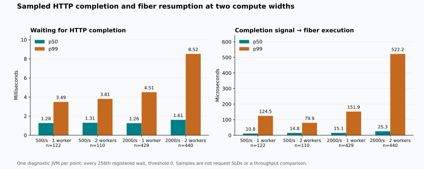

# Downstream HTTP: JFR findings

The profiles point to **heavy compute queueing and competition with the HTTP
path**, rather than a Java busy loop in the fiber scheduler. At 2,000 requests/s,
adding a compute worker reduced heavy queue residence, but sampled HTTP
completion and resumption delays increased. This supports testing the HTTP
callback executor's concurrency next; it does not establish an optimization
or a new throughput result.

The 12 diagnostic runs use the **same Java artifact** as the earlier
[60-run unprofiled comparison](DOWNSTREAM_HTTP_RESULTS.md). Light work already
runs inline on the owner; only heavy work is offloaded. No runtime or bytecode
instrumentation changes were needed.

## Scope and reproduction

The harness/extractor source is
[`b6efc26`](https://github.com/RostMyr/jfibers/commit/b6efc26).
All runs started with clean trees and identical source hashes. The Java artifact
is from `e88d6f8`; its SHA-256 remains
`07c920023ba68e6f638c7b165ce96f7b1c5992b62b3d43aa257ad88ece3be74f`.
The series ran on October 11, 2026, **08:17:56–08:28:57 EDT**
(12:17:56–12:28:57 UTC in the raw metadata).

The workload retains 90% light and 10% heavy requests, three sequential
HTTP/compute steps, 1,000/1,000,000 iterations per step, 1 ms configured dependency
delay, global capacity 64, heavy cap 6, a 100 ms server deadline and a 150 ms
client SLO. This is loopback HTTP, not a remote service or database.

Affinity remains client CPU 0, application CPUs 1,2, dependency CPU 3, under
one shared four-CPU quota. These are guest logical masks, not exclusive cores.
The owner has no reserved CPU. JDK 27+35, 512 MiB G1 heaps and JVM verification
match the previous experiment. VT has two carriers and no compute executor;
its runs in the second width series are fresh controls, not a VT width change.

| Series | Backends | Compute width | Rates/s | Runs | Raw records |
| --- | --- | ---: | --- | ---: | --- |
| Standard JFR, first | Fibers, VT | 1 | 500, 2,000 | 4 | [JSON](results/2026-10-11-downstream-jfr/standard-one/profiles.json) |
| Standard JFR, second | Fibers, VT | 2 | 500, 2,000 | 4 | [JSON](results/2026-10-11-downstream-jfr/standard-two/profiles.json) |
| Custom fiber events, first | Fibers | 1 | 500, 2,000 | 2 | [JSON](results/2026-10-11-downstream-jfr/fiber-events-one/profiles.json) |
| Custom fiber events, second | Fibers | 2 | 500, 2,000 | 2 | [JSON](results/2026-10-11-downstream-jfr/fiber-events-two/profiles.json) |

Each fresh JVM triple gets 15 seconds of warmup and 20 seconds of offered
arrivals. Recording starts after warmup, before baseline snapshots, and ends
after drain. Every workload JVM stops before extraction. There is **one run per
diagnostic configuration**; sequential standard/custom recordings do not measure
profiling overhead or statistical superiority. No builds or other benchmarks ran
concurrently. Client and dependency JVMs are not profiled.

Use the [documented profiles-only command](DOWNSTREAM_HTTP.md#separate-jfr-diagnostics)
with `--standard-jfr`, both backends and width 1, then width 2. Repeat both widths
with `--backends FIBER_POOL_OFFLOAD` and without `--standard-jfr`. Keep the stated
15,000/20,000 ms durations and `--forks 1` to reproduce this matrix.
Each archive folder includes `environment.json`, exact commands, generated
`request-profile.jfc`, recording hashes and standard `.views.txt` extracts.
Binary `.jfr` recordings remain locally under
`/workspace/.jfibers-tools/downstream-jfr/final/`, following the existing Git
ignore rule. They are not embedded in the published extracts.

The configuration uses JDK profile's Java 10 ms/native 20 ms sampling,
allocation samples, 1 ms park/monitor thresholds and 1 s thread CPU-load samples.
Custom runs sample every 256th registered await with a zero duration threshold.
Custom hooks are enabled during warmup; recording is not. Initial environment
variables and system-property events are disabled. `jdk.CPUTimeSample` is not
enabled, and sampled stack counts are **not CPU nanoseconds**.

## Java execution and allocations

The CPU-work column counts Java samples whose stack includes `cpuWork` or
`computeInline`. It is a fraction of **Java execution samples**, not of process
CPU time. Native/kernel/VM work and very short methods are not fully represented.
A small owner count therefore does not make owner handoffs free. Thread roles
are separate from inclusive stack categories; the latter overlap.

| Width series | Rate/s | Backend | Java samples | CPU-work samples (%) | Owner samples | HTTP callback samples | Allocation sample weight MB |
| ---: | ---: | --- | ---: | ---: | ---: | ---: | ---: |
| 1 | 500 | Fibers | 715 | 653 (91.3%) | 6 | 21 | 605.72 |
| 1 | 500 | VT | 786 | 645 (82.1%) | — | 53 | 607.37 |
| 1 | 2000 | Fibers | 2178 | 1922 (88.2%) | 25 | 122 | 2373.51 |
| 1 | 2000 | VT | 3440 | 3208 (93.3%) | — | 98 | 2323.53 |
| 2 | 500 | Fibers | 756 | 689 (91.1%) | 8 | 17 | 625.43 |
| 2 | 500 | VT | 869 | 717 (82.5%) | — | 53 | 611.47 |
| 2 | 2000 | Fibers | 3838 | 3388 (88.3%) | 46 | 280 | 2333.08 |
| 2 | 2000 | VT | 3314 | 3073 (92.7%) | — | 79 | 2312.78 |

The dominant sampled Java work is the benchmark's deterministic CPU loop in
both backends. This does not support rewriting the scheduler around an observed
Java polling hotspot. It does not isolate the total cost of either runtime.

At 500/s every standard run completes the same 10,000 requests and 30,000
physical HTTP calls. Allocation sample weights are 606–625 MB for fibers and
607–611 MB for VT. These are allocation estimates, not retained heap or exact
allocation counts. Under overload the accepted populations differ, so aggregate
MB cannot rank allocation efficiency.

In the one-worker 500/s fiber profile, HTTP callback threads account for
326.53 MB of the 605.72 MB sample weight. Top classes include byte arrays,
`MinimalFuture`, object arrays and map entries. The owner's 97.83 MB also includes
HTTP-client construction and futures; attribution to its thread is not attribution
to the fiber runtime. No fiber-frame allocation hotspot justifies a frame-pooling
change from this evidence alone.

## Waiting for a result versus scheduling after it is ready

Continuation IDs were checked against `javap` on the exact artifact; the
[bytecode dump](results/2026-10-11-downstream-jfr/workload-bytecode.txt) is retained.
For `RequestFiberWorkload$run_Fiber`, state 2 waits for HTTP `openStep`, state 3
for heavy `computeAsync`, and states 4/5/6 are cleanup. Light requests already
compute inline. `FiberPool$Ingress` is reported separately in JSON.

Below, **observed** is suspension to the profiler's completion callback;
**ready → execute** is callback observation to actual fiber execution. HTTP
observed time includes the transport, callbacks and their scheduling; it is not
an isolated network RTT. Compute observed time includes queueing and execution.

| Workers | Rate/s | Wait | Samples | Observed p50 ms | Observed p99 ms | Ready → execute p50 µs | Ready → execute p99 µs |
| ---: | ---: | --- | ---: | ---: | ---: | ---: | ---: |
| 1 | 500 | HTTP | 122 | 1.276 | 3.489 | 10.81 | 124.49 |
| 1 | 500 | Heavy compute | 11 | 2.664 | 3.046 | 20.36 | 36.23 |
| 1 | 2000 | HTTP | 429 | 1.264 | 4.509 | 15.10 | 151.91 |
| 1 | 2000 | Heavy compute | 26 | 13.564 | 16.854 | 34.47 | 69.06 |
| 2 | 500 | HTTP | 110 | 1.306 | 3.811 | 14.83 | 79.86 |
| 2 | 500 | Heavy compute | 15 | 2.748 | 4.013 | 21.79 | 41.76 |
| 2 | 2000 | HTTP | 440 | 1.612 | 8.517 | 25.31 | 522.18 |
| 2 | 2000 | Heavy compute | 30 | 10.851 | 18.112 | 15.98 | 4525.72 |

The small compute groups contain only **11–30 samples**. Their p99 is the largest
sample and is not a reliable estimate of all heavy jobs' tail. Sampling is
systematic, already-completed futures need not register waits, and per-request
latency is not reconstructed from these groups. State-2 events cannot separate
light and heavy requests. These are descriptive samples, not population SLOs.

At 2,000/s, the one-worker compute wait's p50 is 13.564 ms, while its resumption
p50 is 34.47 µs. The full request counters independently record heavy compute-queue
p50 of **28.433 ms**, falling to **12.715 ms** with two workers. That counter is a
per-request sum for jobs that started, includes zero for refused requests, and
excludes jobs cancelled before starting; it differs from a sampled single wait.

The second worker does not remove the HTTP-side cost: HTTP observed p99 changes
from **4.509 to 8.517 ms**, and callback-to-execution p99 from **0.152 to 0.522 ms**.
At width 2, its components have p99 of 0.265 ms before the owner enqueues the
fiber and 0.176 ms on the ready queue; percentiles must not be added. One sampled
compute resumption takes 4.526 ms, almost all before owner enqueue, but 30 samples
cannot establish how frequent such outliers are.

## Owner counters and HTTP locks

Only differences between the first and last scheduler snapshots within each
recording are used. These intervals exclude the recording edges. Execution and
parked values are wall time, not CPU time; an OS-descheduled owner may contribute
to either. Periodic queue observations do not reconstruct the actual phase peak.

| Workers | Rate/s | Snapshot interval s | Execution wall s | Parked wall s | Execution steps | Unpark calls | Poll waits | Stale signals |
| ---: | ---: | ---: | ---: | ---: | ---: | ---: | ---: | ---: |
| 1 | 500 | 19.008 | 0.650 | 18.332 | 68594 | 40555 | 0 | 0 |
| 1 | 2000 | 20.006 | 1.706 | 18.234 | 272133 | 159587 | 0 | 0 |
| 2 | 500 | 19.014 | 0.760 | 18.224 | 68330 | 40356 | 0 | 0 |
| 2 | 2000 | 20.010 | 1.819 | 18.120 | 256257 | 154108 | 0 | 1 |

No polled-Future waits appear in these intervals. The single stale signal in the
two-worker overload recording is a discarded completion signal, not a protocol
failure or evidence that the cancellation regression returned.

The standard one-worker overload profile has 35 owner `JavaMonitorEnter` events
above 1 ms, totalling 97.8 ms. With two workers it has 93, totalling 240.8 ms.
The most frequent owner stack enters `HttpClientImpl.sendAsync`. Callback-thread
monitor waits frequently enter `EPollSelectorImpl.wakeup` while returning
connections to the pool. Their totals are 592.0 and 1,371.0 ms respectively.
VT controls also show callback monitor waits: 708.7 and 550.5 ms.

These sums overlap across threads and are not lost CPU time. They do not prove
a single cause of the end-to-end gap, nor establish that fibers always have more
HTTP contention. They do show that an asynchronous API can briefly block its
calling owner and that HTTP dispatch/selector coordination deserves an explicit
concurrency experiment. Most recorded parks are executor/owner idle waits, so
counting all parks as harmful contention would be misleading.

## Validation and diagnostic outcomes

All 12 runs pass lifecycle probes, admission and outcome reconciliation,
physical-call completion/validation, dependency response accounting, empty-queue
checks and six affinity boundaries per run. No recording reports `jdk.DataLoss`.
Raw source/JAR/settings/recording hashes and derived counts were checked.
The profile path creates no `results.json` or performance summary; the ordinary
summarizer refuses diagnostic directories and records.

| Outcome | Recorded workload | Warmup, not recorded |
| --- | ---: | ---: |
| Offered / dispatched | 300,000 / 300,000 | 225,000 / 225,000 |
| Timely HTTP 200 | 291,084 | 193,998 |
| Late HTTP 200 | 0 | 39 |
| HTTP 503 | 8,790 | 28,818 |
| HTTP 504 | 126 | 2,145 |
| Local drops / transport errors / HTTP 500 / normal-traffic 409 | 0 / 0 / 0 / 0 | 0 / 0 / 0 / 0 |
| Completed and validated downstream calls | 873,630 | 588,159 |

The recorded calls have exactly 20,967,120 bytes; warmup calls have 14,115,816
bytes. Separate lifecycle checks add 36 downstream calls (864 bytes).
The 126 recorded timeouts are 124 in the one-worker standard overload recording
and two in the two-worker custom recording. These outcomes establish integrity
under diagnostic load, not a speed comparison or measured profiling overhead.
All six 500/s recorded workloads complete all 60,000 offered requests on time.

Validation includes five new Python tests covering counter intervals, allocation
weights, sample separation, wait grouping and rejection of profiled performance
data, plus two diagnostic and four unprofiled smoke JVM triples. The historical
48-run performance summary reproduces exactly. The Java artifact is unchanged
from its successful 122-test verification; those Java tests were not rerun for
these Python/documentation changes.

## Next experiment

Keep the current compute-width default. Make the downstream callback executor's
currently fixed **four threads** configurable and compare **1, 2 and 4** with
both backends at the same two application CPUs, retaining compute widths 1/2,
admission, workload and physical cleanup checks. This tests whether reducing
HTTP callback/selector competition recovers CPU budget and light-request latency
without starving dependency progress. The expectation is a hypothesis, not a
promised speedup; do not lower the default before this test.

Use unprofiled repeated runs for acceptance: timely goodput, light/heavy
availability, successful latency and deadline/cleanup behavior. Pair diagnostic
runs with them to check monitor stacks and await delays. If precise per-role CPU
cost is needed, add JDK CPU-time sampling rather than treating Java execution
sample percentages as CPU shares. Check losses/support before interpreting it.

A scheduler rewrite, fiber-frame pooling or a runtime bytecode agent is not
justified by these profiles. Existing optional JFR hooks and compile-time
transformation are sufficient for the next experiment.
