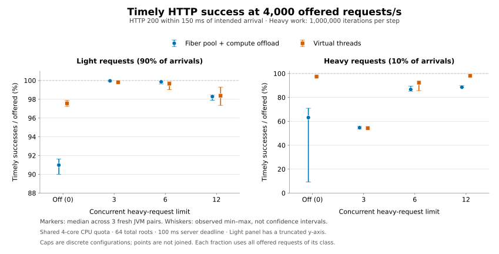

# Heavy-request admission: repeated HTTP results

A limit of six concurrent heavy requests improved the overloaded fiber/offload
configuration on this machine. At 4,000 offered requests/s, median timely goodput
rose from **3,471 to 3,939/s (+13.5%)**. Light timely success rose from **90.981%
to 99.856%** of offered light traffic, and heavy timely success from **63.150% to
86.625%** of offered heavy traffic. All three cap-six runs had zero server
timeouts, versus 813–3,306 per run without the heavy gate.

The matched virtual-thread result at cap six was **3,953/s [3,903, 3,964]**, versus
**3,939/s [3,931, 3,940]** for fibers. Those ranges overlap; this is evidence for
improving this fiber application's overload policy, not a general scheduler
speed advantage. Virtual threads at cap six had higher median heavy availability,
92.350% versus 86.625%, with overlapping ranges. The gate is optional benchmark
application policy, not a new priority or scheduling rule in the core library.

## Reproduction and scope

- Source: [`b038f98ee81b09f2876ebde3d1056595a7167f23`](https://github.com/RostMyr/jfibers/commit/b038f98ee81b09f2876ebde3d1056595a7167f23), clean worktree at start.
- Raw [environment](results/2026-10-11-heavy-admission/environment.json),
  [48 JVM pairs](results/2026-10-11-heavy-admission/results.json), and
  [summary](results/2026-10-11-heavy-admission/summary.json).
- UTC interval: **2026-10-11 02:46:26–03:07:55**. Each pair had 15 seconds of
  warmup and 10 seconds of measurement, followed by complete draining.
- Temurin **27+35**, G1, 512 MiB fixed heaps, four active processors and four
  virtual-thread carriers. Both JVMs shared a **four-core cgroup quota**, on an
  AMD EPYC 9V74 host exposing five logical CPUs; memory limit was 16 GiB.
- Two backends × rates 2,000/4,000 × heavy limits off/3/6/12 × three fresh JVM
  repetitions. Order rotated; all disabled-gate controls used the same new code
  and artifact. No other builds or benchmark processes ran concurrently.
- Successful normal requests perform three rounds of 1 ms synthetic asynchronous
  waiting and integer mixing: 90% light at 1,000 iterations/step, 10% heavy at
  1,000,000. Global capacity 64, client in-flight bound 512, server deadline
  100 ms, client SLO 150 ms. The same intended ID sequence is used for all caps
  and backends at each rate, independent of lifecycle checks.
- The heavy slot covers the complete request through cleanup and actual compute
  exit. Excess heavy work gets HTTP 503 before any synthetic computation. See
  [policy and exact commands](HEAVY_ADMISSION.md) and [HTTP protocol](REQUEST_HTTP.md).

Fibers use one owner plus three compute threads; virtual threads compute on
four carriers. HTTP runs over loopback between separate client/server JVMs;
asynchronous business dependencies are synthetic. This compares the complete
harness, including transport and application admission, under this CPU budget.
The archived [initial HTTP report](REQUEST_HTTP_RESULTS.md) is context, not an
additional control repetition: counters and lifecycle/arrival protocol changed.

All table entries are **median [minimum, maximum] of three per-JVM measurements**;
ranges that collapse at displayed precision are omitted. Ranges are descriptive,
not confidence intervals.
Percentiles are never pooled. Goodput includes the final drain and only counts
HTTP 200 received within the client SLO. A fast 503 remains a failed offered
request. Each measurement offers 18,000 light + 2,000 heavy requests at 2,000/s,
or 36,000 light + 4,000 heavy at 4,000/s.

## At 4,000 offered requests/s

| Backend | Heavy cap | Timely goodput /s | Light timely / offered % | Heavy timely / offered % |
| --- | --- | --- | --- | --- |
| Fibers + offload | off | 3471 [3311, 3549] | 90.981 [90.006, 91.622] | 63.150 [9.225, 70.950] |
| Fibers + offload | 3 | 3810 [3808, 3817] | 99.961 [99.908, 100.000] | 54.675 [53.425, 55.850] |
| Fibers + offload | 6 | 3939 [3931, 3940] | 99.856 [99.622, 99.903] | 86.625 [85.125, 89.425] |
| Fibers + offload | 12 | 3886 [3877, 3892] | 98.286 [97.894, 98.447] | 88.550 [88.400, 89.900] |
| Virtual threads | off | 3897 [3884, 3911] | 97.567 [97.242, 97.878] | 97.400 [96.975, 97.850] |
| Virtual threads | 3 | 3807 [3806, 3820] | 99.819 [99.797, 100.000] | 54.225 [54.150, 56.050] |
| Virtual threads | 6 | 3953 [3903, 3964] | 99.658 [99.031, 99.886] | 92.350 [85.675, 93.200] |
| Virtual threads | 12 | 3928 [3890, 3968] | 98.383 [97.350, 99.294] | 98.175 [97.375, 99.225] |

For fibers, cap six improved both classes against the disabled gate, with
non-overlapping ranges for each class and total goodput. It was also the highest
goodput of the tested fiber limits in every repetition. Cap three served only
53–56% of heavy demand. Its three slots cover waiting as well as computation,
so they do not guarantee that all three compute threads stay busy; server CPU
fell to about 2.1 cores with that cap. Cap six allows more overlap between the
wait and compute stages. Cap twelve served somewhat more heavy demand in the
median, with overlap, but reduced light availability and increased latency.
This is a tradeoff among request classes; a high total rate alone can hide a
poor result for the 10% heavy class.

Virtual threads already served 96.975–97.850% of heavy demand without a heavy
gate. Cap six increased their median light availability and lowered successful
latencies, while reducing median heavy availability. Cap twelve retained much
more heavy availability; its goodput ranges overlap with cap six. These results
do not establish one best limit for both execution models or all service goals.

## At 2,000 offered requests/s

| Backend | Heavy cap | Timely goodput /s | Light timely / offered % | Heavy timely / offered % |
| --- | --- | --- | --- | --- |
| Fibers + offload | off | 1999 | 100.000 | 100.000 |
| Fibers + offload | 3 | 1988 [1987, 1988] | 100.000 | 94.800 [94.300, 95.050] |
| Fibers + offload | 6 | 1994 [1993, 1999] | 99.806 [99.767, 100.000] | 99.700 [99.150, 100.000] |
| Fibers + offload | 12 | 1998 | 100.000 | 100.000 |
| Virtual threads | off | 1998 [1998, 1999] | 100.000 | 100.000 |
| Virtual threads | 3 | 1987 [1982, 1988] | 100.000 [99.717, 100.000] | 94.400 [94.100, 95.000] |
| Virtual threads | 6 | 1998 [1979, 1998] | 100.000 [99.061, 100.000] | 100.000 [98.450, 100.000] |
| Virtual threads | 12 | 1998 | 100.000 | 100.000 |

Both backends served every offered request with the gate disabled or at cap
twelve. Cap three rejected roughly 5–6% of heavy requests even at this rate;
the extra light rejections in one virtual-thread run were from the global gate.
Cap six occasionally produced both heavy-gate and global-capacity rejections.
Small per-run differences cannot be attributed solely to the heavy gate, but
its recorded direct heavy rejections are an explicit availability cost. There
were no measured timeouts at 2,000/s with any cap. The disabled gate remains
the default; these measurements do not justify imposing a universal cap of six.

## Rejection reasons and completed work at 4,000/s

Heavy and global admission failures are counted separately; when both limits
are full, heavy rejection has precedence. Each percentage below uses offered
heavy traffic, except the explicitly conditional timeout column.

| Backend | Heavy cap | Heavy-gate 503 / offered % | Global 503 / offered % | 504 / offered % | 504 / accepted % |
| --- | --- | --- | --- | --- | --- |
| Fibers + offload | off | 0.000 | 8.725 [8.125, 9.950] | 26.900 [20.325, 82.650] | 29.872 [22.268, 89.959] |
| Fibers + offload | 3 | 45.325 [44.150, 46.575] | 0.000 | 0.000 | 0.000 |
| Fibers + offload | 6 | 13.350 [10.450, 14.875] | 0.025 [0.000, 0.125] | 0.000 | 0.000 |
| Fibers + offload | 12 | 10.950 [9.050, 10.975] | 0.625 [0.475, 0.850] | 0.025 [0.000, 0.200] | 0.028 [0.000, 0.222] |
| Virtual threads | off | 0.000 | 2.600 [2.125, 3.025] | 0.000 [0.000, 0.025] | 0.000 [0.000, 0.026] |
| Virtual threads | 3 | 45.750 [43.950, 45.850] | 0.000 [0.000, 0.025] | 0.000 | 0.000 |
| Virtual threads | 6 | 7.600 [6.750, 13.900] | 0.050 [0.050, 0.425] | 0.000 | 0.000 |
| Virtual threads | 12 | 0.000 [0.000, 0.050] | 1.775 [0.775, 2.625] | 0.000 | 0.000 |

Every measured light failure was a global-capacity 503. With fibers, its median
fraction fell from 9.019% without the heavy gate to 0.144% at cap six. Heavy
rejections rose from 8.725% to 13.375%, but removing heavy timeouts more than
compensated: heavy timely success also increased. For cap three, early rejection
was much more aggressive and median heavy success fell below the disabled-gate
median despite eliminating timeouts. Separately calculated medians need not
add up to exactly 100%; raw per-run outcomes do.

The new counters track completed integer-mixing loops, aggregated only after
terminal cleanup. All measured non-success computation belonged to heavy HTTP
504 outcomes; there were no measured cancellations or errors.

| Backend | Heavy cap | 504 count per run | Iterations on non-success outcomes / all iterations % | Mean completed CPU steps per 504 |
| --- | --- | --- | --- | --- |
| Fibers + offload | off | 1076 [813, 3306] | 28.244 [20.787, 87.307] | 2.780 [2.509, 2.808] |
| Fibers + offload | 3 | 0 | 0.000 | — |
| Fibers + offload | 6 | 0 | 0.000 | — |
| Fibers + offload | 12 | 1 [0, 8] | 0.019 [0.000, 0.192] | 2.312 [2.000, 2.625] |
| Virtual threads | off | 0 [0, 1] | 0.000 [0.000, 0.025] | 3.000 |
| Virtual threads | 3 | 0 | 0.000 | — |
| Virtual threads | 6 | 0 | 0.000 | — |
| Virtual threads | 12 | 0 | 0.000 | — |

Without the heavy gate, fibers completed a median 2.780 of three CPU steps per
timed-out request. Those outcomes consumed 2.260–8.295 billion integer iterations
per run: a median **28.244% [20.787%, 87.307%]** of recorded iterations. At cap
six, every completed measured iteration belonged to a successful request.
The engine therefore avoided substantial computation that otherwise ended in
504, while completing more offered work from both classes. Process CPU stayed
near 3.2 server cores; the improvement did not require a large reduction in
server CPU use.

These are **work counts, not CPU-time shares**. They exclude scheduling, timers,
HTTP, GC, rejection handling and other runtime costs; work ending in a late HTTP
200 would also be excluded from the non-success numerator. A completed loop is
counted even if cancellation was requested during it. The figures show work on
requests that eventually timed out, not the precise time after expiry. There
are only two defined per-run mean-steps samples for fibers cap twelve and one
for virtual threads without the gate; the other runs had no 504. Dashes mean an
undefined denominator, not zero work per timeout.

## Successful-response latency at 4,000/s

These p99 values are milliseconds from intended arrival to validated response,
conditional on HTTP 200. They exclude rejected and timed-out requests; use them
with the offered-success fractions above. All measured HTTP 200s met the 150 ms
client SLO, but server-success latency can exceed the 100 ms server deadline
because client, HTTP and response-write delays are outside that deadline.

| Backend | Heavy cap | Light p99 ms | Light samples per run | Heavy p99 ms | Heavy samples per run |
| --- | --- | --- | --- | --- | --- |
| Fibers + offload | off | 25.538 [21.554, 32.284] | 32753 [32402, 32984] | 113.653 [111.166, 117.132] | 2526 [369, 2838] |
| Fibers + offload | 3 | 12.819 [11.020, 12.901] | 35986 [35967, 36000] | 23.615 [21.624, 25.272] | 2187 [2137, 2234] |
| Fibers + offload | 6 | 14.492 [14.286, 15.632] | 35948 [35864, 35965] | 28.906 [26.537, 30.506] | 3465 [3405, 3577] |
| Fibers + offload | 12 | 19.535 [18.874, 23.259] | 35383 [35242, 35441] | 52.977 [51.255, 53.345] | 3542 [3536, 3596] |
| Virtual threads | off | 27.111 [24.954, 30.337] | 35124 [35007, 35236] | 36.961 [35.491, 38.045] | 3896 [3879, 3914] |
| Virtual threads | 3 | 14.039 [10.453, 14.225] | 35935 [35927, 36000] | 24.886 [19.695, 25.365] | 2169 [2166, 2242] |
| Virtual threads | 6 | 16.435 [14.491, 23.210] | 35877 [35651, 35959] | 26.278 [22.120, 32.719] | 3694 [3427, 3728] |
| Virtual threads | 12 | 23.413 [19.119, 34.155] | 35418 [35046, 35746] | 32.436 [27.729, 46.408] | 3927 [3895, 3969] |

Fiber cap six reduced light p99 from 25.538 to 14.492 ms and heavy p99 from
113.653 to 28.906 ms while increasing, rather than reducing, each class's number
of successes against the disabled-gate baseline. Its light p99 median was lower
than matched virtual threads (16.435 ms), with overlapping ranges. Heavy latency
and availability show why this is not a universal fiber advantage.

## CPU budget and generator behavior

CPU values represent average process cores over each process's own window;
the server snapshot window is slightly wider than the client's timed interval.
Arrival lag measures the client's delay in issuing its intended schedule, not
server queueing. The common client did not drop any measured arrivals.

| Backend | Heavy cap | Server CPU cores | Client CPU cores | Arrival-lag p99 ms |
| --- | --- | --- | --- | --- |
| Fibers + offload | off | 3.174 [3.161, 3.213] | 0.801 [0.759, 0.817] | 13.581 [10.909, 17.274] |
| Fibers + offload | 3 | 2.125 [2.083, 2.149] | 0.639 [0.636, 0.655] | 1.909 [1.792, 2.148] |
| Fibers + offload | 6 | 3.164 [3.144, 3.179] | 0.751 [0.702, 0.762] | 3.734 [3.599, 4.330] |
| Fibers + offload | 12 | 3.219 [3.208, 3.234] | 0.752 [0.731, 0.769] | 10.225 [9.743, 13.484] |
| Virtual threads | off | 3.407 [3.380, 3.416] | 0.501 [0.491, 0.533] | 5.925 [5.296, 8.839] |
| Virtual threads | 3 | 2.161 [2.132, 2.163] | 0.527 [0.515, 0.580] | 2.303 [2.221, 2.399] |
| Virtual threads | 6 | 3.216 [3.133, 3.234] | 0.532 [0.495, 0.619] | 2.344 [2.225, 4.323] |
| Virtual threads | 12 | 3.403 [3.361, 3.405] | 0.499 [0.497, 0.507] | 4.186 [2.572, 8.948] |

The fiber disabled-gate case had appreciable generator lag, and admission caps
also changed the load seen by the shared client and HTTP adapter. This prevents
attributing all improvement to scheduler internals. Across the entire sweep,
the cgroup reported 4,285 throttled periods out of 12,873 and 207.504369 aggregate
throttled seconds. Those deltas include JVM startup, lifecycle checks, warmup
and measurement; aggregate throttled time is not lost wall-clock time. Per-pair
cgroup snapshots are retained in the raw records.

## Validation and next step

Local `clean verify` with `benchmarks,code-analysis` passed **110 tests**, including
14 request-engine tests and the HTTP lifecycle-registration test. Fourteen
additional short HTTP pairs covered all four backends with the gate disabled,
all four selected caps on offload/virtual threads, and the equal-heavy/global-
capacity edge case. These short runs are correctness checks, not performance
samples. Static analysis introduced no findings in handwritten benchmark code;
the five existing core/instrumentation findings remain, and generated JMH code
continues to produce separate findings.

The complete sweep validated all 48 pairs and 96 warmup/measurement intervals:

| Outcome | Measurement | Warmup, excluded from reported performance |
| --- | ---: | ---: |
| Offered | 1,440,000 | 2,160,000 |
| Dispatched | 1,440,000 | 2,149,117 |
| Timely HTTP 200 | 1,400,181 | 1,908,547 |
| Late HTTP 200 | 0 | 9,887 |
| HTTP 503, heavy gate | 15,472 | 35,913 |
| HTTP 503, global gate | 19,142 | 184,360 |
| HTTP 504 | 5,205 | 10,410 |
| Local in-flight rejection | 0 | 10,883 |
| Transport errors / HTTP 500 / normal-traffic HTTP 409 | 0 / 0 / 0 | 0 / 0 / 0 |

In particular, cap-six warmups across both rates and backends had 46 timeouts,
2,657 late HTTP 200s and 2,205 local rejections. Zero measured timeouts are an
observed warmed-run result, not a guarantee for startup or traffic bursts.

Separate lifecycle checks exercised 3,576 work requests, including 3,372 explicit
cancellations, 48 deadlines and 84 overload rejections. Every task, heavy slot,
completion publication, source, timer, compute job and HTTP exchange drained.
Client/server statuses, reason headers, completed CPU-work bounds and checksums
reconciled. All 24 recorded source hashes matched the working-tree source files;
the JAR hash matched the measured artifact. All 16 groups had exactly three
repetitions, and the saved summary
reproduced exactly from raw records. The artifact SHA-256 is
`0236d1e3468f2419e6f9068df237432e3b10fff81a5bcec3727bd16ea56110d2`.

For this workload, **cap six is a useful candidate when protecting light traffic
and total goodput is the goal**. A requirement to serve at least 99% of heavy
demand would not be met at 4,000/s by any tested fiber configuration. Cap twelve
trades some light service for heavy service, and neither runtime has a universal
best setting. Keep the limit configurable and choose it against per-class SLOs.

The next experiment should keep this admission accounting but use a real
asynchronous downstream dependency and a load generator on separate CPU
resources. Vary heavy-request share and burstiness, then recheck per-class
availability and deadline behavior. That provides a stronger basis for a
reusable application admission API or adaptive limit than this single synthetic
mix. The current gate needs no runtime bytecode instrumentation; optional JFR
could later help explain queueing and throttling. This sweep collected neither
profiler samples nor a new retained-memory comparison.
